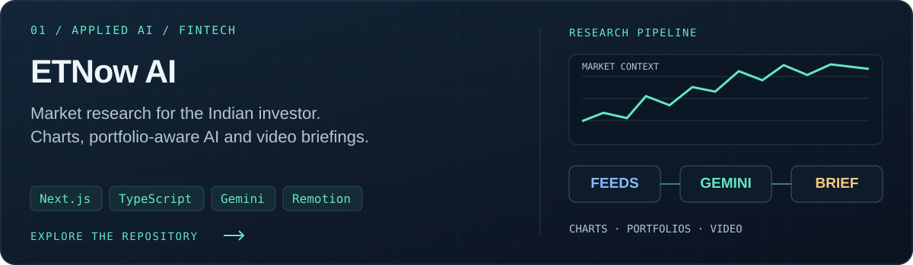
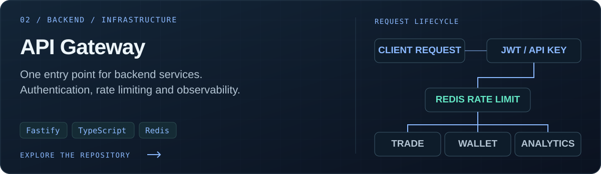
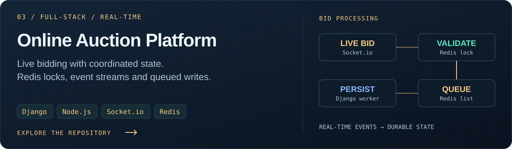
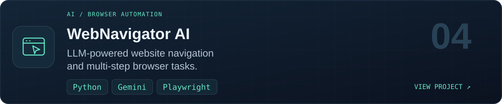
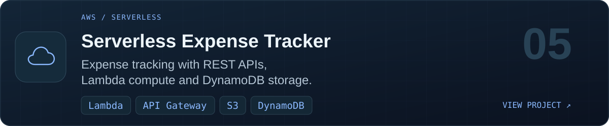
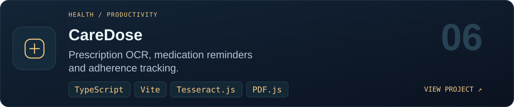
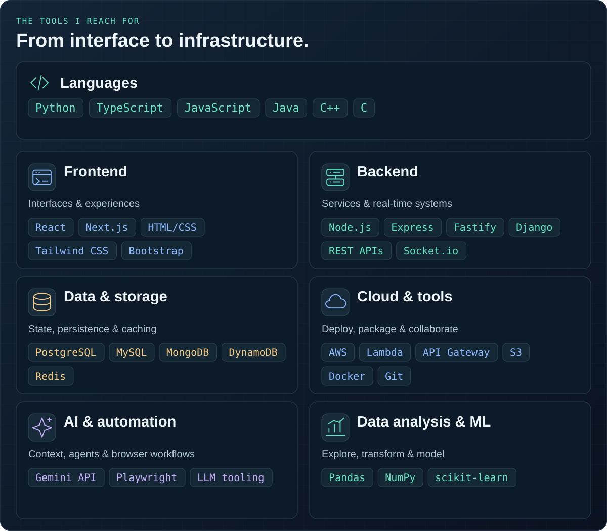
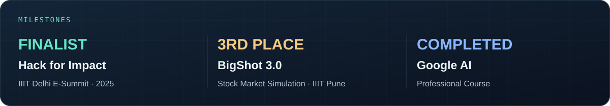
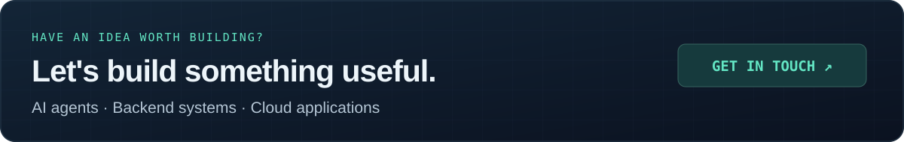

  

  
  
  
  

  <a href="#about-me">About</a> &nbsp; / &nbsp;
  <a href="#selected-projects">Projects</a> &nbsp; / &nbsp;
  <a href="#toolkit">Toolkit</a> &nbsp; / &nbsp;
  <a href="#highlights">Highlights</a> &nbsp; / &nbsp;
  <a href="#github-stats">GitHub Stats</a> &nbsp; / &nbsp;
  <a href="#connect">Connect</a>

## About me

I'm **Jaya Surya**, a B.Tech Computer Science student at **IIIT Pune (2023–2027)**. I build the systems behind useful products: APIs that connect services, real-time backends that coordinate state, and AI tools that work with context.

- **Building** → AI agents, full-stack applications and serverless cloud projects.
- **Exploring** → LLM tooling, the Model Context Protocol (MCP) and AWS architecture.
- **Practicing** → Data structures, algorithms and competitive programming.

## Selected projects

### 01 · ETNow AI

Market charts, technical indicators, portfolio-aware research chat and programmatic video briefings in one terminal for Indian investors.

**Engineering focus:** typed market-data adapters, timestamped data and explicit fallbacks, streaming AI responses, and shared video preview/export compositions.

[Explore ETNow AI →](https://github.com/Jaysurya046/ETnow-PS-6-AI-for-the-Indian-Investor)

### 02 · API Gateway

A single entry point for trade, wallet and analytics services, with JWT/API-key authentication, Redis-backed rate limits and request proxying.

**Engineering focus:** authentication hooks, configurable per-route limits, structured logging and Prometheus metrics.

[Explore API Gateway →](https://github.com/Jaysurya046/Low-Latency-API-Gateway-with-Auth-Rate-Limiting)

### 03 · Online Auction Platform

A full-stack marketplace combining Django auction management, a Node.js/Socket.io bidding service, and Next.js and React interfaces.

**Engineering focus:** Redis locking for bid validation, real-time state updates and queued writes processed by a Django worker.

[Explore Online Auction Platform →](https://github.com/Jaysurya046/Online-Auction-Bidding-Platform)

### More things I've built

<a href="https://github.com/Jaysurya046/WebNavigator-AI">
  <picture>
    <source media="(max-width: 600px)" srcset="./assets/more-webnavigator-mobile.svg" />
    
  </picture>
</a>

<a href="https://github.com/Jaysurya046/Serverless_Expense_Tracker">
  <picture>
    <source media="(max-width: 600px)" srcset="./assets/more-expense-mobile.svg" />
    
  </picture>
</a>

<a href="https://github.com/Jaysurya046/CareDose">
  <picture>
    <source media="(max-width: 600px)" srcset="./assets/more-caredose-mobile.svg" />
    
  </picture>
</a>

[Financial Portfolio Tracking & Alerts](https://github.com/Jaysurya046/Financial-Portfolio-Tracking-and-Alert-System) &nbsp; · &nbsp; [Browse all repositories →](https://github.com/Jaysurya046?tab=repositories)

## Toolkit

<picture>
  <source media="(max-width: 600px)" srcset="./assets/toolkit-mobile.svg" />
  
</picture>

View toolkit as text

- **Languages:** Python · TypeScript · JavaScript · Java · C++ · C
- **Frontend:** React · Next.js · HTML/CSS · Tailwind CSS · Bootstrap
- **Backend:** Node.js · Express · Fastify · Django · REST APIs · Socket.io
- **Data & storage:** PostgreSQL · MySQL · MongoDB · DynamoDB · Redis
- **Cloud & tools:** AWS · Lambda · API Gateway · S3 · Docker · Git
- **AI & automation:** Gemini API · Playwright · LLM tooling
- **Data analysis & ML:** Pandas · NumPy · scikit-learn

## Highlights

### Competitive programming

I practice algorithms alongside my project work. Personal best ratings:

| Platform | Personal best | Profile |
| :--- | :--- | :--- |
| **CodeChef** | 2-star · **1474** | [jaysurya046](https://www.codechef.com/users/jaysurya046) |
| **Codeforces** | **1009** | [jaysurya046](https://codeforces.com/profile/jaysurya046) |

## GitHub Stats

  
  

[View my contribution activity →](https://github.com/Jaysurya046?tab=overview)

## Connect

  <a href="mailto:jayasuryachennaboyana@gmail.com">jayasuryachennaboyana@gmail.com</a> &nbsp; · &nbsp;
  <a href="https://www.linkedin.com/in/jaysurya046">LinkedIn</a> &nbsp; · &nbsp;
  <a href="https://github.com/Jaysurya046?tab=repositories">GitHub projects</a>

