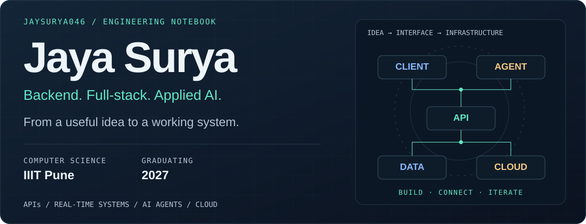

  

<h1 align="center">Hi, I'm Jaya Surya 👋</h1>

  <strong>Computer Science @ IIIT Pune · Class of 2027</strong> 
  Backend &amp; full-stack developer exploring AI agents and cloud systems.

  
  
  
  

  <a href="#about-me">About</a> ·
  <a href="#selected-projects">Projects</a> ·
  <a href="#toolkit">Toolkit</a> ·
  <a href="#highlights">Highlights</a>

## About me

I'm a B.Tech Computer Science student at **IIIT Pune (2023–2027)**. I build across the stack, from APIs and real-time backends to browser agents and financial research tools.

- **Building:** AI agents and serverless cloud applications.
- **Exploring:** LLM tooling, the Model Context Protocol (MCP), and AWS architecture.
- **Practicing:** Data structures, algorithms, and competitive programming.

## Selected projects

A selection of my work across applied AI, backend engineering, and cloud development.

| Project | What it does | Built with |
| :--- | :--- | :--- |
| **[ETNow AI](https://github.com/Jaysurya046/ETnow-PS-6-AI-for-the-Indian-Investor)** | Market research terminal for Indian investors with interactive charts, portfolio-aware AI chat, and market video generation. | Next.js · TypeScript · Gemini · Remotion |
| **[WebNavigator AI](https://github.com/Jaysurya046/WebNavigator-AI)** | LLM-powered browser agent for navigating websites, searching, and automating multi-step web tasks. | Python · Gemini · Playwright |
| **[API Gateway](https://github.com/Jaysurya046/Low-Latency-API-Gateway-with-Auth-Rate-Limiting)** | Service gateway with JWT/API-key authentication, Redis-backed rate limiting, request proxying, and Prometheus metrics. | TypeScript · Fastify · Redis |
| **[Online Auction Platform](https://github.com/Jaysurya046/Online-Auction-Bidding-Platform)** | Auction marketplace with live bidding, Redis-based concurrency control, and asynchronous bid persistence. | Django · Node.js · Socket.io · Next.js |
| **[Serverless Expense Tracker](https://github.com/Jaysurya046/Serverless_Expense_Tracker)** | Expense tracking on AWS with static hosting, REST APIs, Lambda compute, and DynamoDB storage. | Python · Lambda · API Gateway · S3 · DynamoDB |
| **[CareDose](https://github.com/Jaysurya046/CareDose)** | Medication organizer with on-device prescription OCR, reminders, adherence tracking, and printable emergency summaries. | TypeScript · Vite · Tesseract.js · PDF.js |

**More to explore:** [Financial Portfolio Tracking & Alerts](https://github.com/Jaysurya046/Financial-Portfolio-Tracking-and-Alert-System) · [All repositories →](https://github.com/Jaysurya046?tab=repositories)

## Toolkit

| Area | Technologies |
| :--- | :--- |
| **Languages** | Python · TypeScript · JavaScript · Java · C++ · C |
| **Frontend** | React · Next.js · HTML/CSS · Tailwind CSS · Bootstrap |
| **Backend** | Node.js · Express · Fastify · Django · REST APIs · Socket.io |
| **Data & storage** | PostgreSQL · MySQL · MongoDB · DynamoDB · Redis |
| **Cloud & tools** | AWS · Lambda · API Gateway · S3 · Git · Docker |
| **AI & automation** | Gemini API · Playwright · LLM tooling |
| **Data analysis & ML** | Pandas · NumPy · scikit-learn |

## Highlights

- **Finalist** — Hack for Impact, IIIT Delhi E-Summit 2025.
- **3rd place** — BigShot 3.0 Stock Market Simulation, IIIT Pune.
- **Completed** — Google AI Professional Course.

### Competitive programming

| Platform | Personal best | Profile |
| :--- | :--- | :--- |
| CodeChef | **2-star · 1474** | [jaysurya046](https://www.codechef.com/users/jaysurya046) |
| Codeforces | **1009** | [jaysurya046](https://codeforces.com/profile/jaysurya046) |

<strong>GitHub activity &amp; languages</strong>

 

  
  

---

  <strong>Let's build something useful.</strong> 
  Interested in AI agents, backend systems, or cloud applications? 
  <a href="mailto:jayasuryachennaboyana@gmail.com">Email me</a> ·
  <a href="https://www.linkedin.com/in/jaysurya046">Connect on LinkedIn</a>

